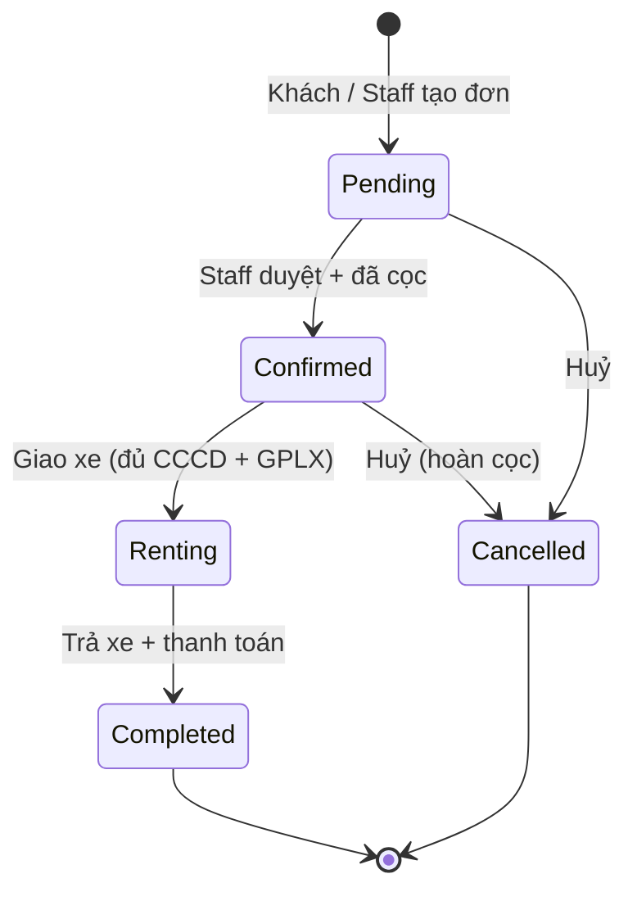
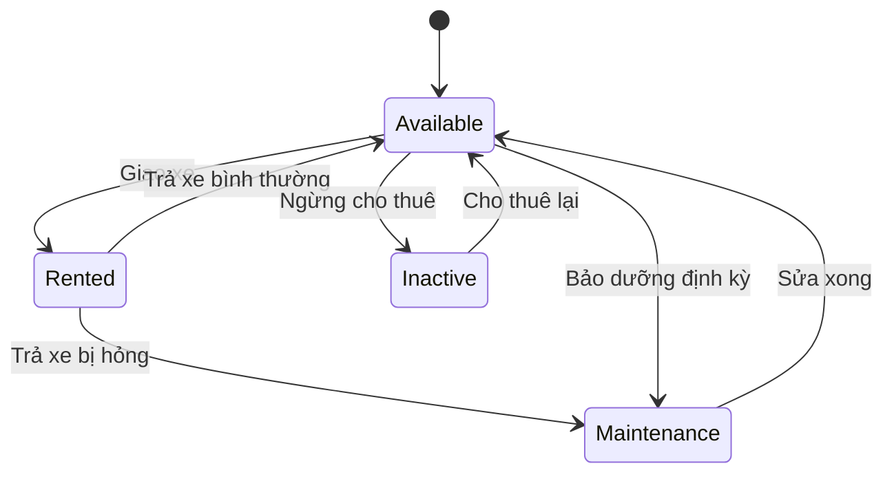

# Luồng nghiệp vụ – Cửa hàng cho thuê xe máy (MotoRent)

> Tài liệu mô tả luồng hoạt động của shop, khớp với database `MotorbikeRentalDB.sql`.
> Các sơ đồ dùng Mermaid – GitHub tự hiển thị thành hình.

---

## 1. Tác nhân và quyền

| Guest | Customer | Staff | Admin |
|---|---|---|---|
| Xem, tìm xe | + Đặt xe | + Duyệt / huỷ đơn | + Quản lý xe, hãng, loại, chi nhánh |
| Xem đánh giá | + Xem / huỷ đơn của mình | + Giao xe, nhận xe | + Quản lý tài khoản (tạo Staff, khoá/mở) |
| Đăng ký, đăng nhập | + Đánh giá xe | + Thu tiền, hoàn cọc | + Xem Dashboard doanh thu |
| | + Sửa hồ sơ (CCCD, GPLX) | + Quản lý bảo dưỡng | |

---

## 2. Luồng thuê xe tổng quát

```mermaid
sequenceDiagram
    actor C as Khách (Customer)
    actor S as Nhân viên (Staff)
    participant H as Hệ thống

    C->>H: 1. Xem / tìm xe (lọc hãng, loại, giá, chi nhánh)
    C->>H: 2. Chọn xe + ngày nhận / ngày trả
    H-->>C: Chỉ hiện xe trống, không trùng lịch
    C->>H: 3. Đặt đơn
    H-->>C: Tạo đơn RNT-yyyyMMdd-xxxx [Pending]
    C->>H: 4. Đặt cọc (chuyển khoản / Momo / VNPay)
    S->>H: 5. Duyệt đơn
    H-->>S: Đơn → [Confirmed]
    C->>S: 6. Đến cửa hàng nhận xe
    S->>H: 7. Kiểm tra CCCD + GPLX, ghi số km, tình trạng xe, giao xe
    H-->>S: Đơn → [Renting], Xe → [Rented]
    Note over C: 8. Sử dụng xe
    C->>S: 9. Mang xe đến trả
    S->>H: 10. Ghi giờ trả, số km, tình trạng; tính tiền; thu tiền + hoàn cọc
    H-->>S: Đơn → [Completed], Xe → [Available] / [Maintenance]
    C->>H: 11. Đánh giá xe (1–5 sao)
```

---

## 3. Chi tiết từng bước

### Bước 1–3: Khách đặt xe (Customer)
- Xem danh sách xe, lọc theo **hãng, loại xe, giá, chi nhánh** (API OData `/odata/Motorbikes`).
- Chọn ngày nhận – ngày trả → hệ thống chỉ hiện xe **Available** và **không trùng lịch** với đơn Pending / Confirmed / Renting khác.
- Một đơn có thể thuê **nhiều xe** (VD: 2 người đi Đà Lạt thuê 2 xe).
- Tính tiền:
  - Tiền thuê từng xe = `giá/ngày × số ngày` (giá được **lưu lại tại thời điểm thuê**)
  - Tiền cọc = tổng tiền cọc các xe
- Tạo đơn mã `RNT-yyyyMMdd-xxxx`, trạng thái **Pending**.

| Bảng liên quan | Ghi gì |
|---|---|
| `Rentals` | 1 dòng đơn thuê |
| `RentalDetails` | 1 dòng / xe |

### Bước 4–5: Đặt cọc & duyệt đơn (Staff)
- Khách đặt cọc → ghi `Payments` loại **Deposit**.
- Staff xem danh sách đơn **Pending** → **Duyệt** hoặc **Huỷ** (bắt buộc ghi lý do).
- Đơn → **Confirmed**, gán `StaffId` người duyệt.

### Bước 6–7: Giao xe (Staff)
- **Bắt buộc** khách có **CCCD + GPLX** trong hồ sơ, thiếu → không giao.
- Ghi số km lúc giao (`PickupOdometer`) và tình trạng xe (`PickupCondition`).
- Đơn → **Renting**, Xe → **Rented**.

### Bước 9–10: Trả xe (Staff)
- Ghi giờ trả thực tế (`ActualReturnDate`), số km (`ReturnOdometer`), tình trạng (`ReturnCondition`).
- Cập nhật số km của xe (`Motorbikes.Odometer`).
- Tính tiền:

| Khoản | Cách tính |
|---|---|
| Tiền thuê | Tổng `giá/ngày × số ngày` các xe |
| Phí trễ (`LateFee`) | Trễ ≤ 1 giờ: miễn phí · Mỗi giờ trễ tiếp theo: +10% giá/ngày · Trễ > 6 giờ: tính thêm 1 ngày |
| Phí hư hỏng (`DamageFee`) | Staff nhập theo thực tế |
| Giảm giá (`DiscountAmount`) | Nếu có, không vượt quá tiền thuê |
| **Tổng** | `Tiền thuê − Giảm giá + Phí trễ + Phí hư hỏng` (DB tự tính cột `TotalAmount`) |

- Ghi `Payments`: **RentalFee** (tiền thuê), **Penalty** (phạt nếu có), **Refund** (hoàn cọc).
- Đơn → **Completed**. Xe → **Available**, hoặc **Maintenance** nếu xe hỏng.
- Toàn bộ bước trả xe chạy trong **1 transaction**.

### Bước 11: Đánh giá (Customer)
- Chỉ được đánh giá khi đơn **Completed** và đơn là **của chính khách đó**.
- Mỗi xe trong 1 đơn chỉ đánh giá **1 lần**, 1–5 sao + bình luận.

---

## 4. Luồng phụ

| Luồng | Ai | Mô tả |
|---|---|---|
| **Huỷ đơn** | Customer (đơn của mình), Staff | Chỉ huỷ được khi đơn **Pending / Confirmed**. Ghi lý do, đã cọc thì hoàn cọc (Payment **Refund**). Đơn → **Cancelled** |
| **Bảo dưỡng** | Staff, Admin | Tạo lịch (**Scheduled**) → đang sửa (**InProgress**, xe → Maintenance, không cho thuê) → xong (**Completed**, xe → Available) |
| **Quản lý danh mục** | Admin | Thêm / sửa / ngừng hoạt động xe, hãng, loại xe, chi nhánh |
| **Quản lý tài khoản** | Admin | Tạo tài khoản Staff (gán chi nhánh), khoá / mở tài khoản |
| **Thống kê** | Admin | Doanh thu theo tháng (tiền thuê + phạt), số lượt thuê, xe được thuê nhiều, điểm đánh giá TB |

---

## 5. Trạng thái

### 5.1 Đơn thuê (`Rentals.Status`)



### 5.2 Xe (`Motorbikes.Status`)



### 5.3 Thanh toán (`Payments`)

| PaymentType | Khi nào | Tính vào doanh thu? |
|---|---|---|
| Deposit | Đặt cọc | ❌ (tiền giữ hộ) |
| RentalFee | Trả xe | ✅ |
| Penalty | Trả trễ / hư hỏng | ✅ |
| Refund | Hoàn cọc khi trả xe / huỷ đơn | ❌ |

---

## 6. Quy tắc nghiệp vụ & validate dữ liệu

> Cột **Kiểm tra ở**: **DB** = ràng buộc trong SQL (CHECK/UNIQUE/FK) · **DTO** = DataAnnotations, trả 400 kèm lỗi từng ô · **Service** = truy vấn DB rồi mới biết đúng/sai (400/404/409).
> Validate ở **nhiều lớp**: DB là lớp bảo vệ cuối, DTO báo lỗi thân thiện, Service kiểm tra nghiệp vụ.
> Trạng thái cột **Code**: ✅ đã có trong code · ⏳ chưa làm (ghi người phụ trách).

### 6.1 Đơn thuê (Rentals – Dev 3)
| # | Quy tắc | Kiểm tra ở | Code |
|---|---|---|---|
| BR1 | Ngày trả phải sau ngày nhận, thuê tối đa 90 ngày | DB (CHECK) + DTO | ⏳ Dev 3 (tìm xe trống đã có: ✅) |
| BR2 | Xe không được trùng lịch với đơn Pending / Confirmed / Renting khác | Service – dùng `IMotorbikeRepository.IsAvailableAsync` | ✅ hàm kiểm tra / ⏳ gọi khi tạo đơn |
| BR3 | Chỉ thuê được xe **không ở trạng thái Maintenance / Inactive**. Xe đang **Rented** vẫn đặt được cho khoảng thời gian *sau* khi trả (nhờ kiểm tra trùng lịch BR2) | Service | ✅ |
| BR4 | Giao xe phải có CCCD + GPLX | Service | ⏳ Dev 3 |
| BR5 | Khách phải đủ 18 tuổi | DB (CHECK) + DTO | ✅ (DB) |
| BR6 | Giá thuê lưu lại tại thời điểm đặt, đổi giá xe sau không ảnh hưởng đơn cũ | `RentalDetails.PricePerDay` | ⏳ Dev 3 |
| BR7 | Chỉ chuyển trạng thái đúng theo sơ đồ 5.1 (VD: không trả xe khi đơn đang Pending) | Service | ⏳ Dev 3 |
| BR8 | Customer chỉ xem / huỷ / đánh giá đơn **của mình** | Service (so `CustomerId` với user trong JWT, dùng `User.GetUserId()`) | ⏳ Dev 3 |
| BR9 | Đánh giá chỉ khi đơn Completed, mỗi xe 1 lần / đơn | Service + DB (UNIQUE) | ⏳ Dev 3 |
| BR10 | Giảm giá không vượt quá tiền thuê | DB (CHECK) | ✅ (DB) |
| BR11 | Email, biển số, CCCD, SĐT không trùng | DB (UNIQUE) | ✅ |
| **BR12** | **Giờ nhận xe và giờ hẹn trả phải nằm trong giờ mở cửa của chi nhánh** (xem 6.2) | Service (+ DTO nếu muốn báo lỗi sớm) | ⏳ **đề xuất – cần nhóm chốt** |

### 6.2 Giờ thuê xe (BR12 – đề xuất)
Database đã có sẵn giờ mở cửa **theo từng chi nhánh** (`Branches.OpenTime`, `Branches.CloseTime`; mặc định 07:00–21:00, chi nhánh Thủ Đức 07:30–20:30) và Admin sửa được ở trang *Quản lý chi nhánh*. Nhưng **chưa có quy tắc nào dùng đến chúng khi tạo đơn**.

Đề xuất áp dụng:
- **Giờ nhận xe** (`StartDate`) và **giờ hẹn trả** (`ExpectedReturnDate`) phải nằm trong `[OpenTime, CloseTime]` của chi nhánh của đơn (`Rentals.BranchId`). Ngoài khung giờ → 400 *"Chi nhánh X mở cửa từ 07:00 đến 21:00, vui lòng chọn giờ trong khung này"*.
- **Không** hard-code "7h–24h" trong code: lấy từ bảng `Branches` để mỗi chi nhánh có giờ riêng. Muốn mở tới nửa đêm thì Admin đổi `CloseTime` = 23:59 (DB có CHECK `CloseTime > OpenTime` nên không dùng được 00:00).
- **Giờ trả thực tế** (`ActualReturnDate`) *không* chặn: khách có thể trả muộn hơn giờ đóng cửa, Staff vẫn nhập được; phí trễ tính như bình thường.
- Dữ liệu mẫu hiện tại đều nằm trong giờ mở cửa (08:00, 09:00, 10:00, 07:00) nên **không cần sửa file SQL**.

Vì sao không đặt trong database:
- Một ràng buộc `CHECK` của SQL Server **không đọc được bảng khác**, mà giờ mở cửa nằm ở bảng `Branches` còn giờ thuê nằm ở `Rentals`.
- Muốn bắt ở DB phải dùng trigger hoặc hàm tự viết — dễ lỗi với EF Core, khó test. Làm ở **Service** (và hiển thị khung giờ cho khách trên form) đơn giản và rõ hơn.

Ai làm: logic nằm trong `RentalService.CreateAsync` / sửa đơn (Dev 3). Nên viết thành **một hàm dùng chung**, VD `BranchHours.IsWithin(branch, DateTime)`, để WebApp cũng dùng được khi giới hạn ô chọn giờ.

### 6.3 Danh mục xe: Hãng, Loại, Xe máy (Dev 2)
| # | Quy tắc | Kiểm tra ở | Code |
|---|---|---|---|
| BR20 | Tên hãng / loại xe: bắt buộc, 2–50 ký tự, **không trùng** (409) | DTO + Service + DB (UNIQUE) | ✅ |
| BR21 | **Không ngừng** hãng / loại còn xe đang hoạt động (xe chưa Inactive) | Service | ✅ |
| BR22 | Xoá hãng / loại / xe là **xoá mềm** (`IsActive = false` hoặc `Status = Inactive`) để giữ lịch sử đơn thuê | Service | ✅ |
| BR23 | Biển số: đúng định dạng (VD `59A1-123.45`), tự **viết hoa**, **không trùng** (409) | DTO (regex) + Service + DB (UNIQUE) | ✅ |
| BR24 | Tên mẫu xe 2–100 ký tự; màu bắt buộc, tối đa 30 ký tự | DTO + DB | ✅ |
| BR25 | Năm sản xuất từ 2000 đến **năm hiện tại + 1** | DTO (attribute tự viết) + DB (CHECK) | ✅ |
| BR26 | Dung tích 50–1500 cc; **bỏ trống** với xe điện | DTO + DB (CHECK) | ✅ |
| BR27 | Giá thuê / ngày từ **10.000 đến 10.000.000** đ; tiền cọc 0 – 100.000.000 đ | DTO + DB (CHECK > 0) | ✅ |
| BR28 | Số km từ 0 đến 1.000.000; khi sửa **không được giảm** so với số km hiện tại | DTO + Service | ✅ |
| BR29 | Hãng, loại, chi nhánh được chọn phải **tồn tại và đang hoạt động** | Service + DB (FK) | ✅ |
| BR30 | Không đổi chi nhánh của xe đang được thuê (**Rented**) | Service | ✅ |
| BR31 | Đổi trạng thái tay chỉ được **Available / Maintenance / Inactive**. **Rented** chỉ do luồng thuê xe đặt | DTO + Service | ✅ |
| BR32 | Xe đang **Rented** không đổi trạng thái được; xe còn đơn Pending / Confirmed / Renting không chuyển sang Maintenance / Inactive | Service | ✅ |
| BR33 | Xe có phiếu bảo dưỡng **đang làm (InProgress)** không đổi trạng thái tay — phải hoàn thành hoặc huỷ phiếu | Service | ✅ |
| BR34 | Tìm xe trống: bắt buộc có ngày nhận + ngày trả, ngày trả > ngày nhận, tối đa 90 ngày, ngày nhận không ở quá khứ | DTO | ✅ |
| BR35 | Upload ảnh xe: chỉ **.jpg / .jpeg / .png / .webp**, tối đa **2 MB**, kiểm tra **nội dung thật** của file (không chỉ đuôi), tên file sinh ngẫu nhiên, ảnh cũ tự xoá | Service (`FileStorageService`) | ✅ |

### 6.4 Bảo dưỡng xe (Dev 2)
| # | Quy tắc | Kiểm tra ở | Code |
|---|---|---|---|
| BR40 | Vòng đời: **Scheduled → InProgress → Completed**; Scheduled / InProgress → **Cancelled**. Chỉ sửa được phiếu còn mở (Scheduled / InProgress) | Service | ✅ |
| BR41 | Nội dung bảo dưỡng 5–500 ký tự; chi phí 0 – 100.000.000 đ | DTO + DB (CHECK) | ✅ |
| BR42 | Ngày bắt đầu không trước hôm nay quá **30 ngày**; ngày dự kiến xong ≥ ngày bắt đầu | DTO + DB (CHECK) | ✅ |
| BR43 | Mỗi xe chỉ có **1 phiếu đang mở**; xe đã ngừng (Inactive) không lên lịch bảo dưỡng | Service (409 / 400) | ✅ |
| BR44 | Không bảo dưỡng **trùng thời gian** xe đã có khách đặt hoặc đang thuê | Service | ✅ |
| BR45 | **Bắt đầu** bảo dưỡng: xe không được đang Rented / Inactive → phiếu InProgress, xe → **Maintenance** (không cho thuê) | Service | ✅ |
| BR46 | **Hoàn thành**: ngày xong không trước ngày bắt đầu và **không ở tương lai** → xe về **Available** | Service | ✅ |
| BR47 | **Huỷ** phiếu đang InProgress → xe về **Available**; phiếu đã Completed / Cancelled không huỷ được | Service | ✅ |

### 6.5 Phân quyền (Dev 1)
| Chức năng | Guest | Customer | Staff | Admin |
|---|---|---|---|---|
| Xem xe, hãng, loại, tìm xe trống | ✅ | ✅ | ✅ | ✅ |
| Thêm / sửa / ngừng / upload ảnh xe, hãng, loại | ❌ | ❌ | ❌ | ✅ |
| Đổi trạng thái xe (Available ↔ Maintenance) | ❌ | ❌ | ✅ | ✅ |
| Phiếu bảo dưỡng, tra cứu đơn thuê (`/odata/Rentals`) | ❌ | ❌ | ✅ | ✅ |
| Chi nhánh, tài khoản, Dashboard | ❌ | ❌ | ❌ | ✅ |

Chưa đăng nhập → **401**; đăng nhập nhưng sai quyền → **403**.

> 📝 **Dev 1 bổ sung:** quy tắc validate của Tài khoản, Đăng ký / Đăng nhập, Đổi mật khẩu, Chi nhánh (VD độ dài mật khẩu, định dạng SĐT / CCCD, giờ mở cửa < giờ đóng cửa…) và Payments khi làm xong.

---

## 7. Kịch bản demo (dùng dữ liệu mẫu, mật khẩu `123456`)

1. **Guest:** vào trang chủ, lọc "Xe tay ga – Honda – giá ≤ 200k".
2. **customer5@example.com:** đăng nhập → thử đặt xe → bị yêu cầu bổ sung CCCD/GPLX khi giao xe → cập nhật hồ sơ.
3. **customer1@example.com:** đặt Honda SH Mode 2 ngày → đơn Pending.
4. **staff1@motorent.vn:** duyệt đơn → giao xe → (giả lập) nhận xe trễ 3 giờ → hệ thống tính phí trễ → hoàn cọc.
5. **customer1:** đánh giá 5 sao.
6. **admin@motorent.vn:** xem Dashboard doanh thu, thêm xe mới, khoá 1 tài khoản.
7. Thử **phân quyền:** Customer gọi API duyệt đơn → bị chặn 403.
