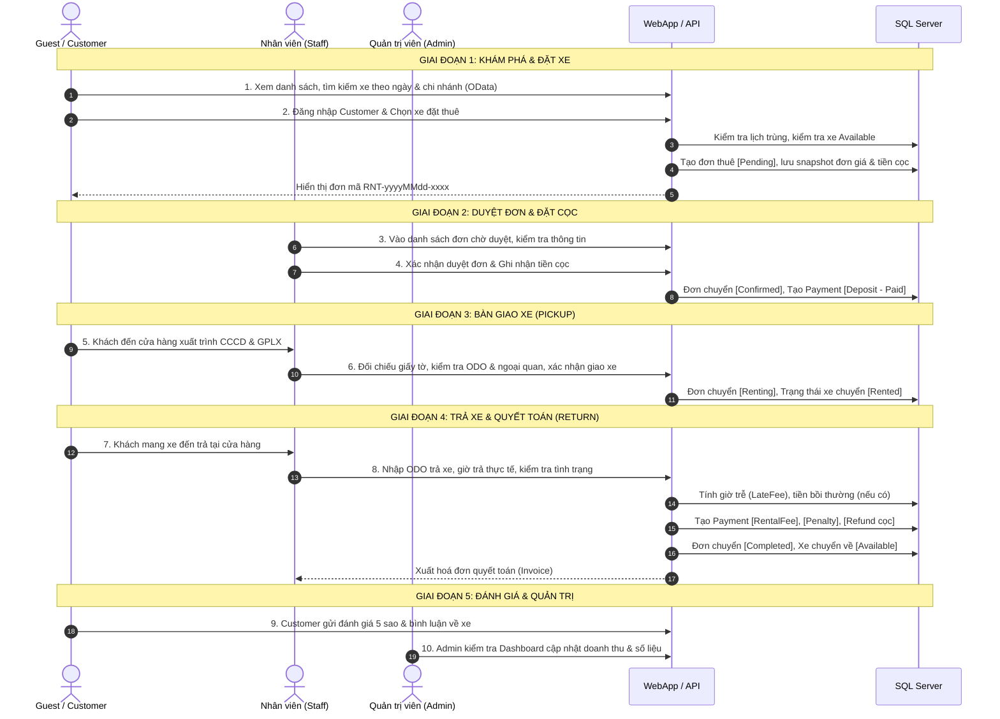

# Kịch bản Kiểm thử Toàn diện Luồng Dự án (End-to-End Test Scenarios & Demo Script)
## Dự án: MotoRent – Hệ thống Quản lý Cho thuê Xe máy (PRN232)

> **Mục đích tài liệu:**  
> Tài liệu này chuẩn hóa toàn bộ kịch bản kiểm thử luồng nghiệp vụ (End-to-End Workflow), phục vụ cho việc kiểm thử tích hợp hệ thống, nghiệm thu đồ án và chuẩn bị bài thuyết trình/demo trực tiếp trước giảng viên và hội đồng.

---

## 1. Môi trường kiểm thử & Dữ liệu chuẩn bị (Pre-conditions)

### 1.1 Khởi động hệ thống
- **Dữ liệu Database:** Chạy file SQL `MotorbikeRentalDB.sql` trên SQL Server để đảm bảo cấu trúc bảng và dữ liệu mẫu chuẩn ban đầu.
- **Backend API:** Chạy project `MotoRent.API` trên cổng: `http://localhost:5001` (Swagger: `http://localhost:5001/swagger`).
- **Frontend WebApp:** Chạy project `MotoRent.WebApp` trên cổng: `http://localhost:5002` hoặc `https://localhost:7002`.

### 1.2 Danh sách tài khoản kiểm thử mặc định (Mật khẩu chung: `123456`)
| Vai trò (Role) | Email | Họ và tên | Trạng thái hồ sơ | Ghi chú |
|---|---|---|---|---|
| **Admin** | `admin@motorent.vn` | Quản Trị Viên | Đầy đủ | Toàn quyền hệ thống, xem Dashboard |
| **Staff** | `staff1@motorent.vn` | Nguyễn Văn Staff | Đầy đủ (Chi nhánh 1 - Quận 1) | Duyệt đơn, giao/nhận xe, bảo dưỡng |
| **Staff** | `staff2@motorent.vn` | Trần Thị Staff | Đầy đủ (Chi nhánh 2 - Bình Thạnh) | Thao tác tại chi nhánh 2 |
| **Customer (Hợp lệ)** | `customer1@example.com` | Nguyễn Văn An | **Đã có CCCD & GPLX** | Dùng cho luồng thuê hoàn chỉnh |
| **Customer (Chưa đủ hồ sơ)** | `customer5@example.com` | Hoàng Thị Mai | **Chưa có CCCD/GPLX** | Dùng để test chặn giao xe |
| **Customer (Bị khoá)** | `customer4@example.com` | Phạm Văn Bị Khoá | Bị khoá (`IsActive = false`) | Dùng để test chặn thao tác |

---

## 2. Sơ đồ Luồng Nghiệp Vụ Chuẩn (Happy Path Overview)

---

## 3. KỊCH BẢN KIỂM THỬ CHI TIẾT

---

### LUỒNG 1: VÒNG ĐỜI THUÊ XE HOÀN CHỈNH (HAPPY PATH - CORE FLOW)
> *Mục tiêu: Đảm bảo luồng kinh doanh cốt lõi từ lúc khách tìm xe đến khi trả xe, xuất hoá đơn, đánh giá và cập nhật doanh thu diễn ra mượt mà, đúng dữ liệu tài chính.*

#### Bước 1.1: Khách vãng lai (Guest) tìm kiếm và lọc xe
- **Tác nhân:** Guest (Chưa cần đăng nhập).
- **Thao tác trên Web:** Truy cập trang chủ `http://localhost:5002/Motorbikes`.
- **Dữ liệu thực hiện:**
  - Nhập từ khoá: `Honda`
  - Chọn Loại xe: `Xe tay ga`
  - Chọn Chi nhánh: `Chi nhánh Quận 1`
  - Khoảng giá: `Dưới 300.000 đ/ngày`
- **Kết quả mong đợi:**
  - Danh sách trả về đúng các xe khớp tiêu chí (ví dụ: Honda Lead, Honda SH Mode, Honda Air Blade).
  - Không xuất hiện các xe đang bảo dưỡng (`Maintenance`) hoặc ngừng hoạt động (`Inactive`).
  - Bấm vào chi tiết xe (Ví dụ: Xe ID 3 - Honda SH Mode) xem được đầy đủ thông số kỹ thuật, hình ảnh, điểm đánh giá trung bình.

#### Bước 1.2: Khách hàng (Customer) đăng nhập & Đặt thuê xe
- **Tác nhân:** Khách hàng `customer1@example.com` / `123456`.
- **Thao tác:**
  - Bấm nút **Đăng nhập**, điền thông tin và xác nhận. Giao diện hiển thị đúng tên "Nguyễn Văn An" trên Header.
  - Tại trang chi tiết xe Honda SH Mode (Xe ID = 3, Chi nhánh 1, Tiền thuê 250.000 đ/ngày, Cọc 2.000.000 đ):
    - Bấm **Thuê xe ngay** (hoặc truy cập `/Rentals/Create?motorbikeId=3`).
    - Chọn **Ngày nhận xe:** `08:00 ngày mai` (VD: `2026-10-27 08:00`).
    - Chọn **Ngày hẹn trả:** `08:00 hai ngày sau` (VD: `2026-10-29 08:00` - 2 ngày thuê).
    - Ghi chú: "Cần kèm 2 nón bảo hiểm 3/4".
    - Bấm **Xác nhận đặt xe**.
- **Kết quả mong đợi:**
  - Tạo đơn thành công, hệ thống điều hướng đến trang Chi tiết đơn thuê (`/Rentals/Details/{id}`).
  - Mã đơn sinh tự động đúng định dạng: `RNT-yyyyMMdd-xxxx`.
  - Trạng thái đơn: `Pending`.
  - Dữ liệu tài chính hiển thị chính xác:
    - Tiền thuê dự kiến: $250.000 \times 2 = 500.000$ đ.
    - Tiền cọc yêu cầu: $2.000.000$ đ.
    - Tổng cộng cần chuẩn bị: $2.500.000$ đ.
    - Đơn giá xe được **snapshot** cố định vào `RentalDetails.PricePerDay = 250000`.

#### Bước 1.3: Nhân viên (Staff) kiểm tra, duyệt đơn & Ghi nhận tiền cọc
- **Tác nhân:** Nhân viên `staff1@motorent.vn` / `123456`.
- **Thao tác:**
  - Đăng nhập tài khoản Staff, truy cập menu **Quản trị / Đơn thuê xe** (`/Admin/Rentals`).
  - Lọc trạng thái `Pending` $\rightarrow$ Thấy đơn mới của khách hàng "Nguyễn Văn An".
  - Bấm **Chi tiết đơn** $\rightarrow$ Bấm nút **Duyệt đơn & Xác nhận cọc**.
  - Form xác nhận:
    - Phương thức thanh toán: Chọn `Chuyển khoản (BankTransfer)` hoặc `Tiền mặt (Cash)`.
    - Mã giao dịch: Nhập `VCB-DEP-001`.
    - Bấm **Xác nhận duyệt**.
- **Kết quả mong đợi:**
  - Thông báo duyệt đơn thành công.
  - Trạng thái đơn chuyển sang: `Confirmed`.
  - Thông tin nhân viên duyệt được gán: `StaffId = 2` (Nguyễn Văn Staff).
  - Tự động sinh 1 bản ghi thanh toán trong bảng `Payments`:
    - Loại thanh toán: `Deposit` (Tiền cọc).
    - Số tiền: `2.000.000 đ`.
    - Trạng thái: `Paid`.
    - Mã tham chiếu: `VCB-DEP-001`.

#### Bước 1.4: Bàn giao xe cho khách tại cửa hàng (Pickup)
- **Tác nhân:** Nhân viên `staff1@motorent.vn`.
- **Thao tác:**
  - Khách hàng đến cửa hàng xuất trình CCCD & Giấy phép lái xe.
  - Staff mở chi tiết đơn thuê $\rightarrow$ Bấm nút **Bàn giao xe** (`/Admin/Rentals/Pickup/{id}`).
  - Hệ thống tự động kiểm tra hồ sơ khách (Customer 1 đã có CCCD và GPLX hợp lệ).
  - Staff điền biên bản giao xe:
    - Số km lúc nhận (`PickupOdometer`): Nhập `15200` km (phải $\ge$ Odometer hiện tại của xe).
    - Tình trạng xe (`PickupCondition`): "Xe sạch sẽ, đầy đủ 2 gương, đầy bình xăng, không trầy xước".
    - Bấm **Xác nhận bàn giao**.
- **Kết quả mong đợi:**
  - Bàn giao thành công.
  - Trạng thái đơn thuê chuyển sang: `Renting` (Đang thuê).
  - Trạng thái xe trong cơ sở dữ liệu chuyển sang: `Rented` (Đã cho thuê).
  - Không thể chỉnh sửa số km nhận hay trạng thái duyệt đơn nữa.

#### Bước 1.5: Khách trả xe & Quyết toán chi phí (Return)
- **Tác nhân:** Nhân viên `staff1@motorent.vn`.
- **Thao tác:**
  - Khách mang xe về chi nhánh trả đúng hẹn (hoặc trễ nhẹ trong phạm vi cho phép).
  - Staff mở chi tiết đơn $\rightarrow$ Bấm nút **Nhận trả xe** (`/Admin/Rentals/Return/{id}`).
  - Điền thông tin quyết toán:
    - Thời điểm trả xe thực tế: Nhập đúng hạn (hoặc trễ dưới 1 giờ).
    - Số km lúc trả (`ReturnOdometer`): Nhập `15380` km (Khách đã chạy 180 km).
    - Tình trạng lúc trả: "Xe nguyên vẹn, máy móc êm, trả đủ mũ bảo hiểm".
    - Giảm giá (`DiscountAmount`): `0`.
    - Xe hư hỏng: Không tích chọn.
    - Phương thức hoàn cọc: Chọn `Tiền mặt (Cash)`.
    - Phương thức thu tiền thuê: Chọn `Chuyển khoản (BankTransfer)`.
    - Bấm **Hoàn tất quyết toán & Trả xe**.
- **Kết quả mong đợi:**
  - Quy trình chạy an toàn trong **1 Database Transaction**:
    1. Trạng thái đơn thuê chuyển sang: `Completed` (Hoàn thành).
    2. Cập nhật Odometer của xe lên `15380` km.
    3. Trạng thái xe tự động phục hồi về: `Available` (Sẵn sàng cho thuê tiếp).
    4. Tự động sinh 2 bản ghi `Payments`:
       - `RentalFee`: `500.000 đ`, trạng thái `Paid` (Ghi nhận doanh thu).
       - `Refund`: `2.000.000 đ`, trạng thái `Paid` (Hoàn trả tiền cọc cho khách).
  - Xem trang In hoá đơn (`/Admin/Rentals/Invoice/{id}`): Hiển thị đầy đủ thông tin cửa hàng, thông tin khách, chi tiết chi phí, tình trạng bàn giao và hoàn cọc rõ ràng.

#### Bước 1.6: Khách hàng đánh giá xe sau khi hoàn thành
- **Tác nhân:** Khách hàng `customer1@example.com`.
- **Thao tác:**
  - Customer đăng nhập $\rightarrow$ Vào trang **Lịch sử thuê xe** (`/Rentals/MyRentals`).
  - Thấy đơn vừa xong ở tab `Completed` $\rightarrow$ Bấm xem chi tiết đơn.
  - Tại danh sách xe trong đơn, xuất hiện form/nút **Viết đánh giá**:
    - Chọn số sao: ⭐⭐⭐⭐⭐ (5 sao).
    - Nhận xét: "Xe chạy rất êm và bốc, tiết kiệm xăng, nhân viên giao xe nhiệt tình chu đáo!".
    - Bấm **Gửi đánh giá**.
- **Kết quả mong đợi:**
  - Đánh giá thành công. Khách không thể đánh giá lần thứ 2 cho cùng chiếc xe trong đơn này (Nguyên tắc nghiệp vụ BR9).
  - Quay lại trang xem chi tiết xe máy `http://localhost:5002/Motorbikes/Details/3`: Đánh giá 5 sao xuất hiện công khai cùng tên khách hàng, điểm đánh giá trung bình của xe được tự động cập nhật lại.

#### Bước 1.7: Quản trị viên (Admin) kiểm tra Dashboard Doanh thu
- **Tác nhân:** Quản trị viên `admin@motorent.vn` / `123456`.
- **Thao tác:**
  - Đăng nhập tài khoản Admin $\rightarrow$ Vào trang **Dashboard** (`/Admin/Dashboard`).
- **Kết quả mong đợi:**
  - Thẻ KPI **Tổng doanh thu:** Tăng thêm đúng `500.000 đ` (Chỉ tính `RentalFee`, không tính tiền cọc `Deposit` hay hoàn cọc `Refund`).
  - Thẻ KPI **Số lượt thuê thành công:** Tăng thêm 1 lượt.
  - Biểu đồ doanh thu 12 tháng: Cột tháng hiện tại tăng lên tương ứng.
  - Bảng **Top xe mang lại doanh thu cao nhất:** Xe Honda SH Mode có thêm lượt thuê và doanh thu mới.

---

### LUỒNG 2: KIỂM THỬ NGOẠI LỆ, RÀNG BUỘC & TÍNH PHÍ PHẠT (NEGATIVE & EDGE CASES)
> *Mục tiêu: Chứng minh tính vững chắc của hệ thống, không để xảy ra sai sót dữ liệu, vi phạm quy tắc nghiệp vụ hoặc gian lận tài chính.*

#### Kịch bản 2.1: Chặn bàn giao xe khi Khách hàng chưa cập nhật CCCD/GPLX
- **Mục đích:** Đảm bảo tuân thủ pháp luật và quy định an toàn (Quy tắc BR4).
- **Các bước thực hiện:**
  1. Đăng nhập tài khoản `customer5@example.com` (Khách hàng mới, hồ sơ chưa có số CCCD và Giấy phép lái xe).
  2. Khách đặt đơn thuê xe ID 5 (Yamaha Exciter) từ `08:00 ngày mai` đến `08:00 ba ngày sau`.
  3. Nhân viên `staff1@motorent.vn` duyệt đơn và xác nhận tiền cọc $\rightarrow$ Đơn chuyển sang `Confirmed`.
  4. Nhân viên bấm **Bàn giao xe** (`/Admin/Rentals/Pickup/{id}`).
- **Kết quả mong đợi:**
  - **Hệ thống chặn lại, hiển thị cảnh báo lỗi (HTTP 400 Bad Request):**
    > *"Khách hàng chưa cập nhật đầy đủ CCCD và Giấy phép lái xe trong hồ sơ cá nhân. Không đủ điều kiện bàn giao xe."*
  - Đơn vẫn giữ nguyên trạng thái `Confirmed`, xe chưa chuyển sang `Rented`.
- **Khắc phục và tiếp tục:**
  - Khách hàng đăng nhập $\rightarrow$ Vào **Hồ sơ cá nhân** (`/Auth/Profile`) $\rightarrow$ Cập nhật CCCD: `079200001234`, GPLX: `B2-79012345` $\rightarrow$ Lưu thay đổi.
  - Nhân viên quay lại thực hiện bàn giao xe $\rightarrow$ **Thành công**.

#### Kịch bản 2.2: Chặn đặt xe bị trùng lịch (Schedule Conflict)
- **Mục đích:** Ngăn ngừa việc 1 xe bị 2 khách hàng thuê cùng một thời điểm (Quy tắc BR2).
- **Các bước thực hiện:**
  1. Đơn của Customer 1 đang thuê Xe ID 3 trong khoảng thời gian từ `2026-10-27 08:00` đến `2026-10-29 08:00`.
  2. Đăng nhập tài khoản Customer khác (`customer2@example.com`).
  3. Tìm kiếm xe hoặc cố tình gửi request đặt đơn chứa Xe ID 3 với thời gian từ `2026-10-28 08:00` đến `2026-10-30 08:00` (trùng ngày 28 và 29).
- **Kết quả mong đợi:**
  - Ở trang tra cứu xe trống (`/api/motorbikes/available`): Xe ID 3 không xuất hiện trong danh sách.
  - Nếu cố tình submit tạo đơn (`POST /api/rentals`): Hệ thống trả về **HTTP 409 Conflict**:
    > *"Xe biển số '59A1-345.67' đã có người đặt trong khoảng thời gian này. Vui lòng chọn xe khác hoặc đổi thời gian thuê."*
  - Không có đơn rác nào được tạo trong Database.

#### Kịch bản 2.3: Xử lý Trả xe Trễ hạn (Tính phí phạt LateFee tự động)
- **Mục đích:** Kiểm tra công thức tính phạt trả trễ chuẩn xác theo đúng nghiệp vụ đã cam kết.
- **Quy tắc tính toán:**
  - Trễ $\le 1$ giờ: Miễn phí (`LateFee = 0`).
  - Trễ từ $1$ giờ đến $6$ giờ: Mỗi giờ trễ phạt $+10\%$ giá thuê ngày.
  - Trễ $> 6$ giờ: Tính phạt trọn $1$ ngày thuê ($100\%$ giá ngày).
- **Các ca thử nghiệm:**
  - **Ca 2.3.1 (Miễn phí trễ):** Hẹn trả 08:00, thực tế trả lúc 08:45 (trễ 45 phút).  
    $\rightarrow$ **Kết quả:** `LateFee = 0`, không tính phạt.
  - **Ca 2.3.2 (Trễ 3 giờ, xe giá 200.000 đ/ngày):** Hẹn trả 08:00, thực tế trả lúc 11:00 (trễ 3 giờ).  
    $\rightarrow$ **Kết quả:** `LateFee = 200.000 \times 10\% \times 3 = 60.000 đ`.  
    Tự động ghi nhận `Payment` loại `Penalty` = $60.000$ đ.
  - **Ca 2.3.3 (Trễ quá 6 giờ):** Hẹn trả 08:00, thực tế trả lúc 16:00 (trễ 8 giờ).  
    $\rightarrow$ **Kết quả:** `LateFee = 200.000 đ` (Tính phạt trọn 1 ngày thuê).

#### Kịch bản 2.4: Trả xe Hư hỏng & Kích hoạt Luồng Bảo dưỡng tự động
- **Mục đích:** Xử lý rủi ro xe tai nạn/hỏng hóc, bồi thường chi phí và chuyển trạng thái xe sang sửa chữa.
- **Các bước thực hiện:**
  1. Đơn đang ở trạng thái `Renting`.
  2. Nhân viên bấm **Nhận trả xe** (`/Admin/Rentals/Return/{id}`).
  3. Tại form trả xe:
     - Tích chọn: ☑ **Xe bị hư hỏng / cần bảo dưỡng**.
     - Nhập Phí bồi thường hư hỏng (`DamageFee`): `350.000 đ`.
     - Nhập mô tả hư hỏng: "Vỡ yếm bên phải, gãy gương chiếu hậu bên trái".
     - Bấm **Hoàn tất quyết toán**.
- **Kết quả mong đợi:**
  - Đơn chuyển sang `Completed`.
  - Tiền phạt bồi thường `350.000 đ` được ghi nhận vào `TotalAmount` và sinh `Payment` loại `Penalty`.
  - Tiền cọc vẫn được hoàn trả riêng biệt theo đúng thủ tục (`Payment` Refund = 2.000.000 đ).
  - **Đặc biệt:** Xe **không** chuyển về `Available` mà tự động chuyển sang trạng thái `Maintenance`. Xe lập tức biến mất khỏi danh sách cho thuê để đảm bảo an toàn.
  - Staff mở menu **Quản lý bảo dưỡng** (`/Admin/Maintenances`) $\rightarrow$ Tạo phiếu bảo dưỡng sửa chữa cho xe này $\rightarrow$ Chuyển `InProgress` $\rightarrow$ Sửa xong bấm `Complete` $\rightarrow$ Xe mới trở lại `Available`.

#### Kịch bản 2.5: Huỷ đơn thuê xe (Cancel Workflow)
- **Mục đích:** Kiểm tra quy trình hoàn cọc và cập nhật trạng thái khi huỷ đơn.
- **Trường hợp 1 (Khách hàng tự huỷ khi còn `Pending`):**
  - Customer 1 vào đơn đang `Pending` $\rightarrow$ Bấm nút **Huỷ đơn** $\rightarrow$ Nhập lý do: "Bận việc đột xuất không đi du lịch nữa".
  - **Kết quả:** Đơn chuyển sang `Cancelled`. Lý do huỷ được lưu. Chưa có tiền cọc nên không phát sinh refund.
- **Trường hợp 2 (Nhân viên huỷ đơn khi đã `Confirmed` - Khách đã đóng cọc):**
  - Đơn đã `Confirmed` (Khách đã đặt cọc 2.000.000 đ).
  - Staff bấm **Huỷ đơn** $\rightarrow$ Nhập lý do: "Khách gọi điện xin huỷ trước 24h theo chính sách" $\rightarrow$ Chọn phương thức hoàn tiền: `Chuyển khoản`.
  - **Kết quả:** Đơn chuyển sang `Cancelled`. Hệ thống **tự động sinh bản ghi Payment** loại `Refund` trị giá 2.000.000 đ ở trạng thái `Paid` để đảm bảo không thất thoát tiền của khách.
- **Trường hợp 3 (Cố tình huỷ khi xe đang chạy):**
  - Thử gửi request huỷ đơn đang `Renting` hoặc `Completed`.
  - **Kết quả:** Hệ thống chặn lỗi 400 Bad Request: *"Không thể huỷ đơn thuê khi đã ở trạng thái Renting/Completed."*

#### Kịch bản 2.6: Kiểm tra Phân quyền chặt chẽ (RBAC Security Test)
- **Mục đích:** Đảm bảo mỗi vai trò chỉ được thao tác đúng phạm vi thẩm quyền được cấp.
- **Các ca thử nghiệm:**
  | # | Tác nhân | Hành động thực hiện | Kết quả mong đợi |
  |---|---|---|---|
  | 1 | Khách hàng (Customer) | Cố truy cập trang Quản trị `/Admin/Dashboard` hoặc `/Admin/Rentals` | **Chặn truy cập** (Redirect về `/Account/AccessDenied` hoặc HTTP 403 Forbidden). |
  | 2 | Khách hàng (Customer) | Gọi API duyệt đơn `PUT /api/rentals/7/confirm` | **HTTP 403 Forbidden**. |
  | 3 | Khách hàng A | Cố tình xem chi tiết đơn của Khách hàng B qua URL `/Rentals/Details/2` | **Báo lỗi:** "Bạn không có quyền truy cập vào thông tin đơn thuê này." |
  | 4 | Chưa đăng nhập (Guest) | Gọi API xem hồ sơ cá nhân `GET /api/auth/me` | **HTTP 401 Unauthorized**. |
  | 5 | Nhân viên (Staff) | Cố xoá tài khoản hoặc xoá chi nhánh trên WebApp | Nút chức năng bị ẩn hoặc báo quyền hạn chỉ dành cho Admin. |

---

## 4. Hướng dẫn Kịch bản Trình bày Demo (Dành cho buổi Báo cáo / Vấn đáp)

Khi thuyết trình trước giảng viên, nhóm có thể thực hiện theo kịch bản 5 phút chuẩn mực sau:

1. **Phút 0 - 1: Giới thiệu tổng quan & Phân quyền hệ thống**
   - Mở màn hình đăng nhập, trình bày 3 nhóm quyền chính: Khách hàng (Customer), Nhân viên chi nhánh (Staff), Quản trị viên (Admin).
   - Đăng nhập `admin@motorent.vn`, mở trang **Dashboard** chỉ ra số liệu tổng quan ban đầu.

2. **Phút 1 - 2: Khách hàng tìm xe & Tạo đơn thuê**
   - Đăng xuất Admin, mở ẩn danh với vai trò Khách vãng lai: Lọc xe OData theo hãng, loại xe, khoảng giá.
   - Đăng nhập `customer1@example.com` $\rightarrow$ Đặt thuê xe Honda SH Mode trong 2 ngày $\rightarrow$ Đơn tạo thành công ở trạng thái `Pending`.

3. **Phút 2 - 3: Nhân viên duyệt đơn & Bàn giao xe**
   - Đổi trình duyệt sang nhân viên `staff1@motorent.vn`.
   - Vào danh sách đơn chờ $\rightarrow$ Duyệt đơn, nhập mã giao dịch cọc 2.000.000 đ $\rightarrow$ Đơn sang `Confirmed`.
   - Khách đến nhận xe: Staff kiểm tra giấy tờ CCCD/GPLX $\rightarrow$ Nhập số ODO bàn giao $\rightarrow$ Bàn giao xe $\rightarrow$ Đơn sang `Renting`, xe chuyển sang `Rented`.

4. **Phút 3 - 4: Trả xe, Quyết toán tài chính & Hoàn cọc**
   - Staff thao tác nhận trả xe: Giả lập khách trả trễ 2 giờ $\rightarrow$ Hệ thống tự động nhảy phí phạt trễ hạn $10\% \times 2$.
   - Bấm quyết toán: Hệ thống hoàn cọc 2.000.000 đ, thu tiền thuê và tiền phạt.
   - Mở trang **Hoá đơn (Invoice)** cho giảng viên xem tính chuyên nghiệp và minh bạch của hệ thống.

5. **Phút 4 - 5: Đánh giá xe, Bảo dưỡng & Doanh thu tự động nhảy**
   - Quay lại tài khoản Customer: Viết review 5 sao cho xe.
   - Quay lại tài khoản Admin: F5 Dashboard $\rightarrow$ Biểu đồ và tổng doanh thu vừa nhảy số chính xác tương ứng với đơn vừa hoàn thành.

---

## 5. Bảng Ma trận Kiểm thử Tự động (Automated Test Execution)

Bộ kiểm thử tự động đã được tích hợp sẵn qua Postman Collection và Newman CLI. Nhóm có thể chạy lệnh để chứng minh chất lượng code:

| Module | Người phụ trách | File Postman Collection | Lệnh chạy tự động (Newman) | Số lượng Test Cases |
|---|---|---|---|---|
| **Dev 1** (Auth, Users, Branches, Dashboard) | Leader (Dev 1) | `docs/postman/MotoRent_Dev1.postman_collection.json` | `npx newman run docs/postman/MotoRent_Dev1.postman_collection.json` | 35 test cases (100% Pass) |
| **Dev 2** (Motorbikes, Brands, Categories, Maintenance, OData) | Dev 2 | `docs/postman/MotoRent_Dev2.postman_collection.json` | `npx newman run docs/postman/MotoRent_Dev2.postman_collection.json` | 57 requests / 92 assertions (100% Pass) |
| **Dev 3** (Rentals Lifecycle, Payments, Reviews, Invoices) | Dev 3 | `docs/postman/MotoRent_Dev3_Rentals.postman_collection.json` | `npx newman run docs/postman/MotoRent_Dev3_Rentals.postman_collection.json` | 56 test cases (100% Pass) |
