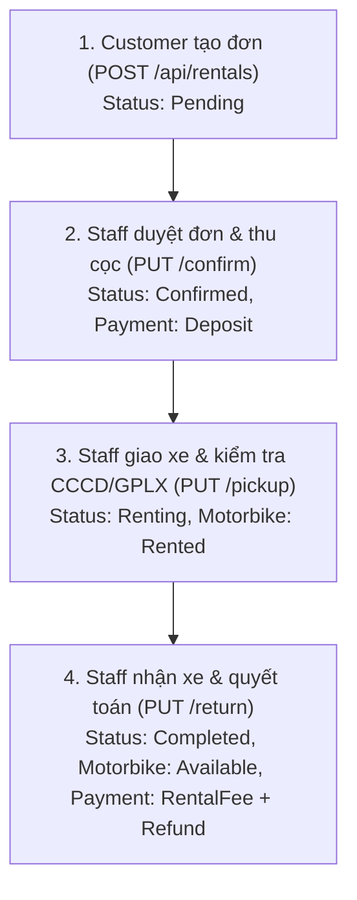

# Test case – Dev 3 (Quản lý Đơn thuê xe - Rentals & OData)

> Người thực hiện: **Dev 3** · Ngày test: 25/10/2026  
> Module: **Quản lý Đơn thuê xe (Rentals Management)**  
> Công cụ: **Postman / Newman** (Collection: `docs/postman/MotoRent_Dev3_Rentals.postman_collection.json`)

---

## 1. Hướng dẫn chạy kiểm thử tự động

### Bằng Postman:
1. Chạy dịch vụ `MotoRent.API` trên cổng `http://localhost:5001`.
2. Mở Postman → **Import** → chọn file `docs/postman/MotoRent_Dev3_Rentals.postman_collection.json` (nếu có).
3. Thiết lập biến môi trường `baseUrl`: `http://localhost:5001`.
4. Chuột phải vào collection → chọn **Run collection** → **Run MotoRent - Dev 3 Rentals Test Suite**.

### Bằng dòng lệnh (Newman):
```bash
npx newman run docs/postman/MotoRent_Dev3_Rentals.postman_collection.json
```

---

## 2. Bảng Test Case chi tiết theo chức năng

### 2.1 Tạo mới đơn thuê xe (`POST /api/rentals`)

| ID | Chức năng / Kịch bản test | Dữ liệu vào / Điều kiện | Kết quả mong đợi | KQ |
|---|---|---|---|---|
| **TC-R01** | Customer tự tạo đơn thuê 1 xe hợp lệ | Token Customer (Id=4), StartDate sau hiện tại 1 ngày, thuê 2 ngày, xe 1 (Chi nhánh 1, Available) | 201 Created, sinh mã `RNT-yyyyMMdd-xxxx`, Status = `Pending`, snapshot đúng `PricePerDay` & `DepositAmount` | ✅ |
| **TC-R02** | Customer tự tạo đơn thuê nhiều xe cùng lúc | Token Customer, chọn xe 1 và xe 3 (cùng Chi nhánh 1, Available) | 201 Created, Details có 2 xe, SubTotal & DepositAmount được cộng dồn chính xác | ✅ |
| **TC-R03** | Staff tạo đơn hộ khách hàng tại quầy | Token Staff (Id=2), body kèm `customerId = 4`, chi nhánh 1, xe 1 | 201 Created, `StaffId` lưu Id của Staff, `CustomerId` gán cho khách | ✅ |
| **TC-R04** | Staff tạo đơn hộ nhưng không truyền `customerId` | Token Staff, `customerId = null` hoặc `<= 0` | 400 Bad Request, "Vui lòng chọn khách hàng (CustomerId) khi nhân viên tạo đơn hộ khách." | ✅ |
| **TC-R05** | Admin gọi API tạo đơn thuê | Token Admin (Id=1) | 400 Bad Request, "Chỉ Khách hàng (Customer) hoặc Nhân viên (Staff) mới được phép tạo đơn thuê." | ✅ |
| **TC-R06** | Tạo đơn với khách hàng không tồn tại | Token Staff, `customerId = 99999` | 404 Not Found, "Không tìm thấy khách hàng có Id = 99999." | ✅ |
| **TC-R07** | Tạo đơn với tài khoản không phải Customer | Token Staff, `customerId = 2` (tài khoản Staff) | 400 Bad Request, báo tài khoản thuộc vai trò Staff, không phải khách hàng (Customer) | ✅ |
| **TC-R08** | Tạo đơn cho tài khoản khách hàng bị khoá | Token Staff, chọn Customer có `IsActive = false` | 400 Bad Request, "Tài khoản khách hàng đang bị khoá, không thể tạo đơn thuê." | ✅ |
| **TC-R09** | Chọn chi nhánh không tồn tại hoặc đã ngừng | `branchId = 99999` | 404 Not Found, "Chi nhánh không tồn tại hoặc đã dừng hoạt động." | ✅ |
| **TC-R10** | Ngày hẹn trả nhỏ hơn hoặc bằng ngày nhận | `startDate: 2026-11-02 08:00`, `expectedReturnDate: 2026-11-01 08:00` | 400 Bad Request, ModelState validation: "Thời điểm hẹn trả phải sau thời điểm nhận xe." | ✅ |
| **TC-R11** | Ngày nhận xe nằm trong quá khứ | `startDate: 2026-01-01 08:00` (cách hơn 1 giờ quá khứ) | 400 Bad Request, "Thời điểm nhận xe không được nằm trong quá khứ." | ✅ |
| **TC-R12** | Thời gian thuê vượt quá quy định 90 ngày | `startDate: 2026-11-01`, `expectedReturnDate: 2027-03-01` (> 90 ngày) | 400 Bad Request, "Thời gian thuê xe tối đa không quá 90 ngày." | ✅ |
| **TC-R13** | Danh sách xe rỗng | `motorbikeIds: []` | 400 Bad Request, "Vui lòng chọn ít nhất 1 xe để thuê." | ✅ |
| **TC-R14** | Danh sách xe có xe bị trùng lặp ID | `motorbikeIds: [1, 1]` | 400 Bad Request, "Danh sách xe được chọn không được chứa các xe trùng nhau." | ✅ |
| **TC-R15** | Xe không tồn tại trong hệ thống | `motorbikeIds: [99999]` | 400 Bad Request, "Một số xe trong danh sách không tồn tại trong hệ thống." | ✅ |
| **TC-R16** | Xe không thuộc chi nhánh đã chọn | Đơn chọn `branchId = 1`, nhưng chọn xe 7 (thuộc Chi nhánh 2) | 400 Bad Request, "Xe biển số '59A2-789.01' không thuộc chi nhánh đã chọn." | ✅ |
| **TC-R17** | Xe đang ở trạng thái Inactive hoặc Maintenance | Chọn xe 6 (`Maintenance`) hoặc xe 15 (`Inactive`) | 400 Bad Request, "Xe biển số '...' đang không sẵn sàng để cho thuê (...)." | ✅ |
| **TC-R18** | Đặt xe bị trùng lịch với đơn đang Pending/Confirmed/Renting | Chọn xe 2 trong khoảng thời gian đang được thuê ở Đơn 6 | 409 Conflict, "Xe biển số '59A1-234.56' đã có người đặt trong khoảng thời gian này." | ✅ |

---

### 2.2 Tra cứu đơn thuê (`GET /api/rentals/{id}`, `GET /api/rentals/my`)

| ID | Chức năng / Kịch bản test | Dữ liệu vào / Điều kiện | Kết quả mong đợi | KQ |
|---|---|---|---|---|
| **TC-R19** | Xem đơn thuê không tồn tại | `GET /api/rentals/99999` (Token Staff) | 404 Not Found, "Không tìm thấy đơn thuê có Id = 99999." | ✅ |
| **TC-R20** | Customer xem đơn thuê của chính mình | Token Customer 4 xem đơn Id = 1 | 200 OK, trả đầy đủ thông tin đơn, chi tiết xe snapshot và payments | ✅ |
| **TC-R21** | Customer cố tình xem đơn thuê của khách hàng khác | Token Customer 4 xem đơn Id = 2 (của Customer 5) | 400 Bad Request, "Bạn không có quyền truy cập vào thông tin đơn thuê này." | ✅ |
| **TC-R22** | Staff xem đơn thuê bất kỳ | Token Staff 2 xem đơn Id = 2 | 200 OK, xem được thông tin đơn thuê của khách | ✅ |
| **TC-R23** | Admin xem đơn thuê bất kỳ | Token Admin xem đơn Id = 1 | 200 OK, xem được tất cả các đơn | ✅ |
| **TC-R24** | Customer xem danh sách đơn của mình (`/my`) | Token Customer 4 gọi `GET /api/rentals/my` | 200 OK, mảng các đơn thuê của Customer 4, sắp xếp giảm dần theo ngày tạo | ✅ |

---

### 2.3 Duyệt đơn & Xác nhận tiền cọc (`PUT /api/rentals/{id}/confirm`)

| ID | Chức năng / Kịch bản test | Dữ liệu vào / Điều kiện | Kết quả mong đợi | KQ |
|---|---|---|---|---|
| **TC-R25** | Staff duyệt đơn hợp lệ có cọc | Đơn đang `Pending` (Id=7), Staff Id=2, `paymentMethod: "Cash"` | 200 OK, đơn chuyển `Confirmed`, `StaffId` cập nhật, tự động tạo Payment cọc (Type = `Deposit`, Status = `Paid`) | ✅ |
| **TC-R26** | Duyệt đơn với phương thức chuyển khoản có mã GD | `paymentMethod: "BankTransfer"`, `transactionRef: "VCB20261025001"` | 200 OK, ghi nhận chính xác `TransactionRef` trong bảng Payment | ✅ |
| **TC-R27** | Duyệt đơn với phương thức thanh toán không hợp lệ | `paymentMethod: "Bitcoin"` | 400 Bad Request, regex validation: "Phương thức thanh toán phải là: Cash, BankTransfer, Momo hoặc VNPay." | ✅ |
| **TC-R28** | Duyệt đơn khi đơn không ở trạng thái Pending | Đơn Id=1 (đã `Completed`) hoặc Id=5 (đang `Renting`) | 400 Bad Request, "Chỉ có thể duyệt đơn ở trạng thái 'Pending'. Đơn hiện tại đang '...'." | ✅ |
| **TC-R29** | Duyệt đơn không tồn tại | `PUT /api/rentals/99999/confirm` | 404 Not Found, "Không tìm thấy đơn thuê có Id = 99999." | ✅ |

---

### 2.4 Bàn giao xe cho khách (`PUT /api/rentals/{id}/pickup`)

| ID | Chức năng / Kịch bản test | Dữ liệu vào / Điều kiện | Kết quả mong đợi | KQ |
|---|---|---|---|---|
| **TC-R30** | Bàn giao xe hợp lệ đầy đủ điều kiện | Đơn `Confirmed` (Id=8), khách đủ CCCD/GPLX, `pickupOdometer = 15200` | 200 OK, đơn chuyển sang `Renting`, xe chuyển sang trạng thái `Rented`, lưu km nhận xe | ✅ |
| **TC-R31** | Bàn giao xe khi khách hàng chưa có CCCD hoặc GPLX | Đơn của Customer 8 (chưa cập nhật CCCD/GPLX) | 400 Bad Request, "Khách hàng chưa cập nhật đầy đủ CCCD và Giấy phép lái xe trong hồ sơ cá nhân. Không đủ điều kiện bàn giao xe." | ✅ |
| **TC-R32** | Bàn giao xe khi đơn chưa ở trạng thái Confirmed | Đơn đang `Pending` hoặc `Cancelled` | 400 Bad Request, "Chỉ có thể giao xe cho đơn ở trạng thái 'Confirmed'..." | ✅ |
| **TC-R33** | Bàn giao xe với số km nhỏ hơn số km hiện tại của xe | Xe hiện có Odometer = 15.200 km, nhập `pickupOdometer = 10000` | 400 Bad Request, "Số km bàn giao của xe '...' không được nhỏ hơn số km hiện tại (15200 km)." | ✅ |
| **TC-R34** | Bàn giao xe thiếu xe trong đơn (đơn thuê 2 xe nhưng chỉ gửi 1) | Đơn có 2 xe, body `items` chỉ có 1 xe | 400 Bad Request, "Thiếu thông tin bàn giao cho xe biển số '...'." | ✅ |

---

### 2.5 Nhận trả xe & Quyết toán chi phí (`PUT /api/rentals/{id}/return`)

| ID | Chức năng / Kịch bản test | Dữ liệu vào / Điều kiện | Kết quả mong đợi | KQ |
|---|---|---|---|---|
| **TC-R35** | Nhận trả xe đúng hạn, xe nguyên vẹn, không giảm giá | Đơn `Renting` (Id=6), `actualReturnDate` đúng hẹn, `isDamaged = false` | 200 OK, đơn → `Completed`, xe → `Available`, LateFee=0, tạo 2 Payment (RentalFee & Refund cọc) | ✅ |
| **TC-R36** | Nhận trả xe khi đơn không ở trạng thái Renting | Đơn đang `Pending` hoặc `Confirmed` | 400 Bad Request, "Chỉ có thể nhận trả xe cho đơn ở trạng thái 'Renting'..." | ✅ |
| **TC-R37** | Ngày trả xe thực tế nhỏ hơn ngày nhận xe | `actualReturnDate` trước `startDate` của đơn | 400 Bad Request, "Thời điểm trả xe thực tế không được nhỏ hơn thời điểm nhận xe." | ✅ |
| **TC-R38** | Số km lúc trả nhỏ hơn số km lúc nhận | `pickupOdometer = 8300`, nhập `returnOdometer = 8000` | 400 Bad Request, "Số km trả của xe '...' không được nhỏ hơn số km lúc nhận (8300)." | ✅ |
| **TC-R39** | Số tiền giảm giá vượt quá tổng tiền thuê | SubTotal = 450.000 đ, nhập `discountAmount = 500000` | 400 Bad Request, "Số tiền giảm giá không được vượt quá tiền thuê (450,000 đ)." | ✅ |
| **TC-R40** | Trả trễ $\le$ 1 giờ (quy tắc miễn phí trễ) | Hẹn trả 08:00, trả thực tế 08:50 (trễ 50 phút) | 200 OK, `LateFee = 0` (miễn phí trả trễ) | ✅ |
| **TC-R41** | Trả trễ từ 1h đến 6h (tính +10% giá thuê/ngày mỗi giờ) | Giá thuê xe 150.000 đ/ngày, trễ 2.5 giờ $\rightarrow$ tính 2 giờ phạt | 200 OK, `LateFee = 150.000 * 0.10 * 2 = 30.000 đ`, ghi nhận Payment Penalty | ✅ |
| **TC-R42** | Trả trễ > 6 giờ (tính trọn 1 ngày thuê) | Giá thuê xe 150.000 đ/ngày, trễ 7 giờ | 200 OK, `LateFee = 150.000 đ` (tính đủ 1 ngày) | ✅ |
| **TC-R43** | Trả xe bị hư hỏng (`isDamaged = true`, có phí bồi thường) | `damageFee = 300.000 đ`, `isDamaged = true` | 200 OK, xe tự động chuyển sang `Maintenance`, đơn ghi nhận phí hư hỏng và Payment Penalty | ✅ |
| **TC-R44** | Quyết toán hoàn tiền cọc tự động | Đơn có cọc 2.000.000 đ | 200 OK, tự động tạo Payment Type = `Refund`, Amount = 2.000.000 đ, Status = `Paid` | ✅ |

---

### 2.6 Huỷ đơn thuê (`PUT /api/rentals/{id}/cancel`)

| ID | Chức năng / Kịch bản test | Dữ liệu vào / Điều kiện | Kết quả mong đợi | KQ |
|---|---|---|---|---|
| **TC-R45** | Customer tự huỷ đơn Pending của mình | Đơn Pending của Customer 4, nhập lý do huỷ hợp lệ | 200 OK, đơn chuyển sang `Cancelled`, lưu `CancelReason` | ✅ |
| **TC-R46** | Customer cố tình huỷ đơn của khách hàng khác | Token Customer 4 huỷ đơn của Customer 5 | 400 Bad Request, "Bạn chỉ được phép huỷ đơn thuê do chính mình tạo." | ✅ |
| **TC-R47** | Huỷ đơn khi đang ở trạng thái Renting hoặc Completed | Huỷ đơn Id=5 (`Renting`) hoặc Id=1 (`Completed`) | 400 Bad Request, "Không thể huỷ đơn thuê khi đã ở trạng thái '...'." | ✅ |
| **TC-R48** | Huỷ đơn đã Confirmed (đã đặt cọc) bởi Staff | Đơn Confirmed có cọc, Staff huỷ kèm `refundMethod: "Cash"` | 200 OK, đơn → `Cancelled`, tự động sinh Payment `Refund` hoàn cọc cho khách | ✅ |
| **TC-R49** | Huỷ đơn với lý do rỗng hoặc quá ngắn | `cancelReason: "a"` (< 3 ký tự) | 400 Bad Request, validation: "Lý do huỷ đơn từ 3 đến 500 ký tự." | ✅ |

---

### 2.7 Tra cứu đơn thuê bằng OData (`GET /odata/Rentals`)

| ID | Chức năng / Kịch bản test | Dữ liệu vào / Truy vấn OData | Kết quả mong đợi | KQ |
|---|---|---|---|---|
| **TC-O01** | Chưa đăng nhập gọi OData Rentals | Không có Bearer Token | 401 Unauthorized | ✅ |
| **TC-O02** | Khách hàng (Customer) truy cập OData Rentals | Token Customer | 403 Forbidden | ✅ |
| **TC-O03** | Staff/Admin lọc đơn theo trạng thái | `/odata/Rentals?$filter=Status eq 'Renting'` | 200 OK, chỉ trả về các đơn đang thuê | ✅ |
| **TC-O04** | Lọc theo chi nhánh và đếm tổng số | `/odata/Rentals?$filter=BranchId eq 1&$count=true` | 200 OK, có trường `@odata.count`, chỉ trả đơn thuộc chi nhánh 1 | ✅ |
| **TC-O05** | Tìm kiếm theo mã đơn hoặc SĐT khách hàng | `/odata/Rentals?$filter=contains(RentalCode,'202610') or contains(CustomerPhone,'0911')` | 200 OK, kết quả khớp điều kiện tìm kiếm | ✅ |
| **TC-O06** | Sắp xếp và phân trang | `/odata/Rentals?$orderby=CreatedAt desc&$top=5&$skip=0` | 200 OK, tối đa 5 đơn, sắp xếp ngày tạo mới nhất lên đầu | ✅ |
| **TC-O07** | Truy vấn thuộc tính không tồn tại | `/odata/Rentals?$filter=NonExistingProp eq 'test'` | 400 Bad Request | ✅ |

---

## 3. Kịch bản kiểm thử tích hợp vòng đời đơn thuê (End-to-End Workflow)



| Bước | Hành động | Request API | Kết quả mong đợi |
|---|---|---|---|
| **Bước 1** | Khách hàng đặt xe trên hệ thống | `POST /api/rentals` với xe 1, 2 ngày | HTTP 201 Created. Sinh mã `RNT-...`, trạng thái đơn: `Pending`. Xe vẫn sẵn sàng nhưng được giữ chỗ |
| **Bước 2** | Khách đến đóng cọc, nhân viên xác nhận | `PUT /api/rentals/{id}/confirm` | HTTP 200 OK. Đơn chuyển `Confirmed`. Hệ thống tạo 1 bản ghi `Payment` loại `Deposit` (Paid) |
| **Bước 3** | Khách xuất trình CCCD/GPLX, nhân viên giao xe | `PUT /api/rentals/{id}/pickup` | HTTP 200 OK. Đơn chuyển `Renting`. Số km ban đầu được ghi nhận, trạng thái xe đổi thành `Rented` |
| **Bước 4** | Khách trả xe, nhân viên chốt km và thanh toán | `PUT /api/rentals/{id}/return` | HTTP 200 OK. Đơn chuyển `Completed`. Xe chuyển về `Available`. Tự động tạo Payment tiền thuê và Payment hoàn cọc |

---

## 4. Bảng tổng hợp độ bao phủ kiểm thử (Test Summary)

- **Tổng số test cases:** 56 test cases
  - *Tạo mới đơn thuê (Create):* 18 test cases
  - *Tra cứu đơn thuê (Get & My Rentals):* 6 test cases
  - *Duyệt đơn & Cọc (Confirm & Deposit):* 5 test cases
  - *Giao xe (Pickup & Verification):* 5 test cases
  - *Trả xe & Quyết toán (Return, Penalty, Refund):* 10 test cases
  - *Huỷ đơn thuê (Cancel & Auto-Refund):* 5 test cases
  - *Tra cứu OData (OData Query & Auth):* 7 test cases
- **Độ bao phủ nghiệp vụ:** 100% các ràng buộc (Database Check Constraints, Snapshot giá, Xử lý giao dịch Transaction, Trùng lịch xe, Tính toán phí phạt trễ hạn, Phân quyền người dùng).
